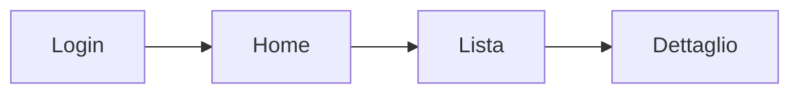

# Progettazione dell'esperienza — la mappa delle schermate

Questa skill esegue la fase descritta nel capitolo `.claude/metodo-villa/20-progettazione-ux.md`.
Il capitolo dice **cosa** e **perche'**; questa skill dice **come si fa**, passo per passo.

## Quando si attiva

- Un progetto **ha un frontend** (web o mobile) e sta per passare dalla progettazione alla
  costruzione: dopo la `discovery`, **prima** del seeding visivo e dei blocchi tecnici.
- Villa chiede di ragionare l'esperienza, i flussi, le schermate.
- **Un frontend esiste gia'** e l'esperienza va rivista, in parte o del tutto: schermate belle
  ma che non si parlano, percorsi confusi, stati mancanti, «va rifatta la UX». → si usa la
  **modalita' C (revisione)**, che parte dal rilievo di cio' che c'e'.

**Non si attiva** se il progetto e' senza interfaccia (API, batch, riga di comando, libreria):
in quel caso dillo e fermati.

## Il risultato: `docs/fondamenta/mappa-esperienza.md`

Un documento **scritto, in bassa definizione**. Non si disegna niente: il bello lo fanno le
skill di seeding. Quattro sezioni, sempre queste:

```markdown
# Mappa dell'esperienza — [NomeProgetto]

## 1. Schermate
Elenco piatto di tutte le schermate. Una riga l'una, con una frase di scopo.

## 2. Navigazione
Modello di navigazione (menu laterale / schede in basso / a livelli) + diagramma:



## 3. Flussi critici (2-4, non di piu')
Per ogni flusso: chi lo fa, da dove entra, i passi, dove si biforca, quando e' "finito".

## 4. Schede per schermata

| Schermata | Da dove ci arrivi | Azione principale | Cosa mostra | Componenti | Stati | Dove ti porta |
|---|---|---|---|---|---|---|
| Lista ospiti | menu laterale | filtrare e aprire un ospite | nome, stato, ultima visita | tabella, filtri, badge stato | pieno / vuoto / caricamento / errore / permesso negato | Dettaglio ospite |
```

**La colonna `Stati` non e' facoltativa.** E' il punto dove un agente lasciato solo sbaglia di
piu': costruisce solo il caso "tutto va bene" e dimentica lista vuota, caricamento, errore,
permesso negato. Ogni schermata che carica o mostra dati dichiara i suoi stati (vedi
`16-design-core.md`, sezione "gli stati che non devono mai mancare").

---

## Passo 0 — Raccogli il materiale e scegli la modalita'

1. Leggi tutto quello che il progetto sa gia': `PROJECT_CONFIG.md`, `ROADMAP.md`, il concept e
   i requisiti in `docs/fondamenta/`, lo schema dati, e — se c'e' — il codice del frontend.
2. Individua i **ruoli utente** (chi usa il prodotto e con quali permessi). Se non sono chiari,
   e' il primo buco da colmare.
3. **Guarda se un frontend esiste gia'.** E' il bivio piu' importante e lo decidi tu, non Villa:
   - **Non esiste ancora** → si progetta da zero: vai al punto 4 e scegli tra A e B.
   - **Esiste gia'** (schermate costruite, anche solo in parte) → **si parte SEMPRE dalla
     modalita' C (revisione)**, che comincia col rilievo di cio' che c'e' e poi usa A o B per
     disegnare il bersaglio. Non saltare mai il rilievo: ridisegnare a memoria fa dimenticare
     schermate che esistono, e il piano nasce gia' sbagliato.

4. **Chiedi a Villa quale modalita' vuole** per la parte di disegno, spiegandogliele in una
   riga l'una:

   > «Posso disegnare la mappa in due modi: **insieme**, una schermata alla volta, dove decidi
   > tu; oppure **da solo**, ragionando su tutti i dati del progetto e mettendomi nei panni di
   > chi lo userà, e poi te la faccio verificare. Come preferisci?»

   Se il progetto e' importante o Villa ha una visione precisa → consiglia la manuale.
   Se e' un prodotto interno o Villa vuole andare veloce → consiglia l'automatica.

---

## Modalita' A — Manuale (🤝, in sessione live)

Stile intervista, **una schermata (o un flusso) alla volta**, come la skill `discovery`.
Regola del Metodo: contatore visibile, motivazione breve, opzioni descritte a parole con la
tua raccomandazione, e **si aspetta la risposta** prima di passare oltre.

### Ordine delle domande

1. **I ruoli** — chi usa il prodotto? Cosa puo' fare ciascuno?
2. **I compiti** — per ogni ruolo: le 3-5 cose che viene a fare. In forma di bisogno reale
   («quando [situazione], voglio [fare questo], così [ottengo quello]»).
3. **I flussi critici** — per i 2-4 compiti piu' importanti: da dove si entra, i passi, dove si
   biforca, cosa vuol dire "finito".
4. **Le schermate** — quali servono per coprire quei flussi. Una alla volta.
5. **Per ogni schermata**, le sei domande secche:
   - Da dove ci si arriva? (spesso piu' di una via)
   - Qual e' **l'unica** azione principale? (se ne hai due, forse sono due schermate)
   - Che dati mostra?
   - Quali componenti servono?
   - **In quali stati puo' trovarsi?** (pieno, vuoto, caricamento, errore, permesso negato,
     primo uso)
   - Dove porta ogni uscita?
6. **La navigazione** — come si tiene insieme il tutto: menu laterale, schede in basso, livelli.

Dopo ogni 4-5 domande fai un mini-riepilogo di cosa avete deciso, così Villa non perde il filo.

Alla fine scrivi `docs/fondamenta/mappa-esperienza.md` e mostralo.

---

## Modalita' B — Automatica (🤖, con revisione chiesta)

L'agente progetta **tutta la mappa da solo**, poi la sottopone. Non e' "inventare": e' una
procedura precisa.

### B1. Immedesimazione (la parte che non si salta)

Per **ogni ruolo utente**, scrivi — prima di pensare alle schermate:

- **Cosa viene a fare** (i suoi 3-5 compiti reali).
- **Di cosa ha bisogno** per farlo (quali dati, quali conferme).
- **Cosa lo preoccupa** (cosa teme di sbagliare, cosa vuole ricontrollare).
- **In che contesto lo usa** (di fretta? al telefono? con le mani occupate? davanti a un
  cliente?). Il contesto cambia la forma della schermata piu' di qualsiasi gusto estetico.

### B2. Cammina i compiti

Per ogni compito, **percorrilo passo per passo** come lo farebbe la persona: «apre l'app →
si trova davanti X → tocca Y → deve vedere Z → conferma → e poi?». Ogni passo che richiede
qualcosa a schermo **genera una schermata o uno stato**. Le schermate nascono da qui, non da
un elenco di funzionalità.

### B3. Ricomponi e controlla la coerenza

Prima di scrivere il documento, verifica da solo:

- [ ] Ogni schermata e' **raggiungibile** (nessuna isola).
- [ ] Ogni schermata ha **una via d'uscita** (nessun vicolo cieco).
- [ ] Ogni flusso critico e' percorribile **dall'inizio alla fine** sulla mappa.
- [ ] Ogni schermata ha **tutti** i suoi stati dichiarati.
- [ ] Ogni schermata ha **una sola** azione principale.
- [ ] I ruoli con permessi diversi hanno il loro stato "permesso negato" dove serve.

### B4. Scrivi e CHIEDI la verifica

Scrivi `docs/fondamenta/mappa-esperienza.md`, poi presentalo a Villa **in linguaggio semplice**
(quante schermate, come si tiene insieme, i flussi principali, cosa hai assunto) e chiedi:

> «Vuoi verificare la mappa prima che si cominci a costruire? **sì / no**»

- **«sì»** → la rivedete insieme, schermata per schermata dove serve.
- **«no»** → si procede, e nel documento si annota che e' stata approvata senza revisione.

### B5. Se Villa non e' presente (runner)

La domanda passa dal **canale Telegram a due sensi** del Metodo: il runner manda la domanda e
**aspetta la risposta**, che Villa puo' dare per iscritto **o con un messaggio vocale** (viene
trascritto in locale). Comando: `./metodo/metodo-telegram.sh chiedi "<domanda>"`.

- Se Villa risponde → si prosegue secondo la sua risposta.
- Se **non** risponde entro il tempo previsto (`TELEGRAM_ATTESA_MAX`, di base 4 ore) → **non si
  tira a indovinare**: si chiude il blocco con `STATUS: CHECKPOINT`, si scrive nell'handoff che
  la mappa e' pronta e attende la verifica, e ci si ferma pulito.
- Se Villa ha **pre-autorizzato** («vai avanti da solo») → si procede e si annota la scelta in
  `docs/diario/decisioni-da-rivedere.md`.

---

---

## Modalita' C — Revisione di un frontend che esiste gia'

Da usare quando il prodotto **ha gia' un frontend** e l'esperienza va rivista (in parte o del
tutto). Non e' un'alternativa ad A e B: le **avvolge**. Prima si rileva cio' che c'e', poi si
disegna il bersaglio (con A o B), poi si confronta e si decide.

> **Perche' il rilievo prima.** Costruendo da zero si immagina; rivedendo si **rileva**. Un
> frontend vero ha schermate che nessuno ricorda, stati mai implementati e vie di navigazione
> che il codice conosce e la memoria no. Ridisegnare a memoria produce un piano che dimentica
> pezzi. Il codice e' la verita', non il ricordo.

### C1. Rilievo — mappare cio' che ESISTE (dal codice, non a memoria)

Leggi il frontend e ricostruisci la realta'. Cerca, secondo lo stack:
- **Web**: le rotte (`router`, `routes`, `App.tsx`), la cartella `pages/`/`views/`/`screens/`,
  i punti di ingresso (`main.tsx`, `index`), i menu e le barre di navigazione.
- **Mobile**: le `Screen`/`Page`, il navigatore (`routes`, `GoRouter`, `Navigator`), la barra
  inferiore.
- Attenzione alle **applicazioni multiple** nello stesso progetto (es. l'app + un pannello di
  amministrazione separato): sono mappe diverse, vanno rilevate entrambe e tenute distinte.

Per **ogni schermata trovata** annota, guardando il codice:

| Schermata | File | Chi ci arriva (ruolo) | Azione principale | Stati GESTITI | Stati MANCANTI | Note |
|---|---|---|---|---|---|---|

Gli **stati mancanti** sono l'oro di questo passaggio: cerca esplicitamente se la schermata
gestisce lista vuota, caricamento, errore, permesso negato. Quasi sempre ne mancano — ed e'
il difetto piu' economico da correggere e piu' visibile per chi usa il prodotto.

Annota anche cio' che **non torna**: schermate irraggiungibili, vicoli ciechi, due schermate
che fanno la stessa cosa, azioni principali doppie sulla stessa pagina.

### C2. Ascolta anche l'uso reale (fonte complementare)

Il codice dice cosa **c'e'**, non cosa **funziona male per chi lo usa**. Se il prodotto e'
provabile, la fonte piu' ricca e' un giro guidato con Villa: usa la skill **`collaudo-guidato`**
(l'umano prova, Claude guida a parole e raccoglie i rilievi). Se esiste gia' un documento di
collaudo in `docs/`, leggilo: quei rilievi valgono piu' di qualsiasi deduzione dal codice.

### C3. Disegna il bersaglio

Ora — e solo ora — disegna la mappa di **come dovrebbe essere**, con la modalita' **A**
(insieme a Villa) o **B** (in autonomia con verifica), esattamente come sopra. Il bersaglio si
disegna partendo dai compiti degli utenti, **non** dalle schermate esistenti: altrimenti si
eredita l'impianto sbagliato che si voleva cambiare.

### C4. Confronta e dai un verdetto a ogni schermata

E' il cuore della revisione. Per ogni schermata, una riga e **una sola etichetta**:

| Verdetto | Quando | Cosa comporta |
|---|---|---|
| **TIENI** | fa la cosa giusta nel posto giusto | nessun lavoro |
| **COMPLETA** | l'impianto e' giusto, mancano stati o pezzi | lavoro piccolo, alto valore: e' qui che di solito sta il guadagno maggiore |
| **RIFAI** | il flusso o la struttura sono sbagliati | lavoro medio/grande: si riprogetta la schermata |
| **UNISCI** | due schermate fanno la stessa cosa | si fondono, una sparisce |
| **TOGLI** | non serve a nessun compito reale | si elimina (meno codice da mantenere) |
| **MANCA** | il bersaglio la prevede e non esiste | si costruisce nuova |

Regola di misura (evita il rifacimento facile): **si RIFA' solo quando il problema e'
strutturale** — il percorso e' sbagliato, la schermata chiede all'utente cose che non sa, due
azioni principali competono. Se il problema e' estetico o mancano stati, si **COMPLETA**: e'
molto meno lavoro e spesso risolve la sensazione di "prodotto fatto male". Buttare e rifare
tutto e' quasi sempre la scelta sbrigativa travestita da scelta coraggiosa.

### C5. Produci il piano di revisione

Il risultato di questa modalita' **non e' solo la mappa**: e' un piano eseguibile. In coda a
`mappa-esperienza.md` aggiungi:

```markdown
## 5. Revisione — stato attuale vs bersaglio
[la tabella dei verdetti]

## 6. Piano di revisione
Ordinato per valore, non per comodita'.
1. [COMPLETA] Stati mancanti sulle schermate piu' usate — lavoro piccolo, effetto immediato
2. [RIFAI] ...
3. [TOGLI] ...
```

Poi **traduci il piano in blocchi di roadmap**: un blocco per intervento (o per gruppo
coerente), etichetta 🤖/👤/🤝, gate di uscita che nomina gli stati da coprire, regola
"1 blocco = 1 verifica". I 🤝 in testa (vedi `14-sequencing-blocchi.md`).

**Ordine consigliato dei lavori**: prima i **COMPLETA** (poco lavoro, molto effetto), poi
**UNISCI/TOGLI** (semplificano e riducono il codice), poi i **RIFAI** (i piu' costosi), infine
i **MANCA**. Se il tempo finisce a meta', con quest'ordine il prodotto e' comunque migliorato.

### C6. Dillo chiaro a Villa prima di partire

La revisione di un frontend esistente e' una **decisione di priorita'**, non un dettaglio
tecnico: mentre si rivede, il prodotto non avanza su altro. Presenta a Villa il quadro in
numeri — quante schermate TIENI / COMPLETA / RIFAI / TOGLI — e la dimensione del lavoro, e
**lascia decidere a lui** se farla adesso, dopo, o solo in parte (per esempio i soli COMPLETA).

---

## Le modalita' si combinano

- **Bozza in automatico + rifinitura manuale**: la strada spesso migliore per un progetto
  grande — B per tutto, poi A sui 2-3 flussi dove si gioca il valore del prodotto.
- **C usa sempre A o B** al suo interno (passo C3) per disegnare il bersaglio.
- **Revisione parziale**: su un prodotto gia' in servizio si puo' applicare C a **una sola
  area** (es. il pannello di amministrazione) invece che a tutto. E' spesso la scelta piu'
  saggia: si migliora dove serve senza fermare il resto.

---

## Passo finale — Consegna alla costruzione

La mappa non e' un documento da archiviare: **e' il piano di lavoro del frontend**.

1. **Traduci la mappa in blocchi di roadmap**: un blocco per schermata (o per gruppo coerente
   di schermate), con il **gate di uscita** che nomina gli stati da coprire. Rispetta la regola
   "1 blocco = 1 verifica" (`10-sizing-blocchi.md`).
2. **Sequencing**: questa fase e' un punto 🤝 → va **in testa** alla fase frontend, seguita dal
   seeding visivo, poi dai blocchi 🤖 (vedi `14-sequencing-blocchi.md`).
3. **Aggancia il seeding**: subito dopo, proponi `seeding-visivo-web` o `seeding-visivo-mobile`
   — sono loro che rendono belle le schermate che questa mappa ha definito.
4. **Dillo ai blocchi**: ogni blocco frontend costruisce **contro** `mappa-esperienza.md`, non
   a naso. Scrivilo nella descrizione dei blocchi.

---

## Cosa NON fare (i paletti anti-burocrazia)

Questa fase deve restare **leggera**. Vietato:

- **Personas** inventate, mappe emotive del viaggio utente, card sorting: cerimonia che non
  serve a un fondatore solo con un agente.
- **Disegni ad alta definizione** fatti a mano: il bello lo fa il seeding, rifarlo qui e' lavoro
  doppio.
- **Processo Figma** obbligatorio.
- **Flussi dettagliati per ogni schermata**: solo i 2-4 critici meritano il passo-passo. Per il
  resto basta la riga nella tabella.
- **Ingrassare il documento**: se supera le 3-4 schermate di lettura per un'app media, hai messo
  dentro cose che non servono.

Regola di misura: la cura cresce **solo** dove il percorso si biforca o dove "girano soldi".

---

## Lista di controllo prima di chiudere

- [ ] `docs/fondamenta/mappa-esperienza.md` esiste e ha tutte e quattro le sezioni.
- [ ] Ogni schermata ha la colonna **Stati** compilata.
- [ ] I flussi critici sono 2-4, non di piu'.
- [ ] Nessuna schermata isolata, nessun vicolo cieco.
- [ ] In modalita' automatica: Villa ha risposto alla domanda di verifica (o ha
      pre-autorizzato, e la scelta e' annotata).
- [ ] I blocchi frontend della roadmap sono stati scritti a partire dalla mappa.
- [ ] Il seeding visivo e' stato proposto come passo successivo.

**In piu', se era una revisione (modalita' C):**

- [ ] Il rilievo e' stato fatto **leggendo il codice**, non a memoria — e copre tutte le
      applicazioni del progetto (app principale + eventuali pannelli separati).
- [ ] Per ogni schermata esistente sono annotati gli **stati mancanti**.
- [ ] Ogni schermata ha **un solo** verdetto (TIENI / COMPLETA / RIFAI / UNISCI / TOGLI / MANCA).
- [ ] I RIFAI sono giustificati da un problema **strutturale**, non estetico.
- [ ] Il piano e' ordinato **per valore** (prima i COMPLETA), non per comodita'.
- [ ] Villa ha visto il quadro in numeri e ha deciso **se e quanto** fare adesso.

## Riferimenti

- `.claude/metodo-villa/20-progettazione-ux.md` — il capitolo (cosa e perche')
- `.claude/metodo-villa/16-design-core.md` — gli stati che non devono mai mancare, i pattern
- `.claude/skills/seeding-visivo-web/SKILL.md` e `seeding-visivo-mobile/SKILL.md` — il passo dopo
- `.claude/skills/discovery/SKILL.md` — il passo prima (Fase 9bis la propone)
- `metodo/metodo-telegram.sh` — il canale per chiedere a Villa quando non e' al computer
