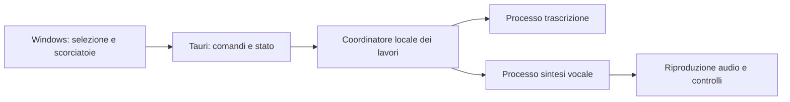

# Analisi di Whisper4Windows e sintesi vocale locale

Aggiornamento: **16 ottobre 2026**. Ricerca documentale e analisi del codice,
con verifiche di base; nessun confronto acustico o nuovo motore installato.
Integra e aggiorna la ricerca del 14 ottobre, preservandone i vincoli.

Il confronto sperimentale successivo a questa analisi e' ora disponibile in
[`confronto-voci-2026-10-16.md`](confronto-voci-2026-10-16.md): 16 campioni CUDA
prodotti; le dichiarazioni di mancata prova qui sotto descrivono il momento
dell'analisi documentale, non lo stato successivo dell'esperimento.

## 1. Obiettivo confermato da Mario

Uso principale: ascoltare **il testo selezionato**, con la migliore qualita'
vocale possibile, soprattutto in italiano. Non e' richiesto uno studio per
produrre video o gestire personaggi. Funzioni accessorie utili all'esperienza
sono benvenute. La naturalezza viene prima della massima velocita'; non sono
stati concordati tempi di attesa numerici.

Caso d'uso di riferimento: Mario seleziona un brano nell'app in cui lavora,
attiva la lettura con una scorciatoia e ascolta senza dover incollare il testo
in una seconda finestra. Puo' fermare o sospendere la lettura. Quando vuole
dettare, il programma coordina microfono e riproduzione.

Il mandato precedente comprende piano, implementazione, test e installer.
Questo aggiornamento completa l'analisi richiesta e fissa la priorita' di
prodotto; **non certifica la scelta del motore ne' realizza la funzione**.
Restano elaborazione locale, conservazione della dettatura, nessun cambio
automatico di driver/PATH/runtime di sistema e nessun cloud implicito.

## 2. Giudizio sul progetto attuale

**Conservare la base e ristrutturare i punti che impediscono una seconda
funzione vocale affidabile.** Dalla lettura del codice non emerge una ragione
per cambiare Tauri, riscrivere il frontend con un framework diverso o sostituire
faster-whisper prima di avere una regressione misurata.

La divisione principale e' gia' sensata: Windows e scorciatoie in Rust/Tauri,
audio e inferenza in Python, interfaccia locale HTML/JavaScript. Ci sono
impostazioni persistenti, scelta microfono/modello/dispositivo, appunti,
modalita' di trascrizione, ripiego CPU e recupero del sidecar terminato.
La buona efficacia nell'uso quotidiano e' riferita da Mario; qui non e' stata
ricollaudata con una dettatura reale.

### Riscontri e priorita'

| Riscontro | Evidenza nel codice attuale | Conseguenza e proposta |
|---|---|---|
| Errore di avvio microfono ignorato | `backend/audio_capture.py:127` restituisce `False` in caso di errore; `backend/main.py:354` ignora l'esito e alla riga 357 imposta lo stato di registrazione | Difetto riprodotto con acquisizione simulata. Propagare l'errore ed evitare una falsa registrazione |
| Scaricamento modello con reset CUDA | `backend/whisper_engine.py:254`, chiamata `cudaDeviceReset()` | Potenziale interferenza con un TTS nello stesso processo. Isolare i motori e rivedere il rilascio memoria |
| Timeout senza interruzione del lavoro nativo | `backend/main.py:456`, inferenza in executor con `asyncio.wait_for` | La scadenza interrompe l'attesa, non garantisce l'arresto del thread. Serve un worker terminabile e una gestione esplicita del lavoro ancora attivo |
| Cambio modello fuori dal lock della registrazione | `backend/main.py:221` contro `/start`, `/stop`, `/cancel` | Possibile gara con l'inferenza. Rischio statico, non riprodotto qui; serializzare cambi e lavori per motore |
| Recupero automatico limitato ai processi terminati | `frontend/src-tauri/src/lib.rs:1062`; polling stato in `frontend/dist/index.html:1289` | Il controllo UI puo' mostrare un servizio irraggiungibile e offre riavvio manuale; il watchdog non risolve automaticamente un processo vivo ma bloccato |
| API e WebView in configurazione di sviluppo | CORS aperto in `backend/main.py:127`; `csp: null` in `frontend/src-tauri/tauri.conf.json` | Prima della distribuzione, limitare origini, autenticare la sessione locale, validare richieste e ridurre superfici WebView. Il binding loopback da solo non autentica i chiamanti |
| Dipendenze e download non riproducibili | Versioni minime in `backend/requirements.txt`; `_get_wheel_url()` in `backend/gpu_manager.py:195` sceglie l'ultima versione PyPI e non usa il digest disponibile | Fissare combinazioni collaudate, verificare hash, gestire download incompleti e preparazione offline |
| Build verificata attraverso file gia' presenti | `BUILD_BACKEND.bat` e `BUILD_INSTALLER.bat` cercano EXE/MSI esistenti senza una catena affidabile di controllo degli esiti | Un vecchio artefatto puo' nascondere un errore nuovo. Verificare esito, provenienza, versione e pacchetto appena generato |
| Appunti preservati solo come testo | `frontend/src-tauri/src/lib.rs:173` legge `CF_UNICODETEXT` | Per catturare selezioni, non riusare questa funzione come backup completo: immagini e formati ricchi richiedono altro trattamento |
| Codice concentrato in pochi file | Rust principale 1.537 righe; pagina impostazioni 2.280; API Python 689 | Separare responsabilita' quando si integrano i nuovi percorsi. La dimensione da sola non giustifica una riscrittura generale |

Non sono stati eseguiti attacchi alla API o test di blocco GPU. Dove manca una
riproduzione, la tabella descrive rischi ricavati dal codice, non guasti
osservati durante l'uso di Mario.

## 3. Come e' stata condotta la ricerca

Ricerca su repository e schede dei produttori, documentazione runtime,
pubblicazioni, articoli di settore, Reddit e YouTube. Le conclusioni tecniche
qui sotto si appoggiano alle **fonti primarie** collegate accanto ai fatti.
Articoli, discussioni e video servono a individuare candidati e problemi da
provare. Non sono un confronto controllato fra voci italiane.

Non esiste, nei materiali esaminati, una prova comparabile su tutti questi
motori che dimostri quale voce piacera' di piu' a Mario sulla sua macchina.
Un punteggio globale, il numero di lingue o una demo inglese non risolvono
questa scelta. Correttezza delle parole, accento, prosodia e piacevolezza
durante dieci minuti di ascolto vanno valutati separatamente.

## 4. Motori da considerare per la massima qualita' italiana

| Motore | Perche' interessa | Limite pratico per questo progetto | Licenza dichiarata |
|---|---|---|---|
| **Qwen3-TTS 1.7B / 0.6B** | Italiano, creazione della voce e clonazione; candidato iniziale forte | Le 9 voci CustomVoice non includono una madrelingua italiana; confrontare Base con riferimento italiano e VoiceDesign | Apache-2.0 per modelli/tokenizer; [repository](https://github.com/QwenLM/Qwen3-TTS), [rapporto tecnico](https://arxiv.org/abs/2601.15621) |
| **Chatterbox Multilingual V3, 0.5B** | Italiano tra le 23 lingue; modello relativamente compatto per il confronto | Usare la variante multilingue. Gli autori raccomandano riferimenti nella lingua di destinazione | MIT; [repository e varianti](https://github.com/resemble-ai/chatterbox), [scheda](https://huggingface.co/ResembleAI/chatterbox) |
| **VoxCPM2, 2B** | Italiano fra 30 lingue, voce progettata/clonata, uscita 48 kHz | Gli autori indicano circa 8 GB VRAM; consumo da verificare su Windows e insieme a Whisper. I 48 kHz non dimostrano da soli una voce migliore | Apache-2.0 per codice e pesi; [repository](https://github.com/OpenBMB/VoxCPM), [modello](https://huggingface.co/openbmb/VoxCPM2) |
| **Fun-CosyVoice3, 0.5B** | Italiano supportato, controlli espressivi e streaming | Integrazione articolata e diversi percorsi accelerati. Verificare il funzionamento Windows del percorso scelto, senza trasferire automaticamente risultati Linux | Apache-2.0; [repository ufficiale](https://github.com/QwenAudio/CosyVoice), [modello](https://huggingface.co/FunAudioLLM/Fun-CosyVoice3-0.5B-2512) |
| **MOSS-TTS v1.5, 8B** | Italiano fra 31 lingue, lettura lunga, controllo di pause e pronuncia | Piu' grande. Il percorso BF16 non va presunto adatto a 12 GB; esistono vie quantizzate, ma occorre verificare versione dei pesi e runtime | Apache-2.0; [modello v1.5](https://huggingface.co/OpenMOSS-Team/MOSS-TTS-v1.5), [runtime ufficiale](https://github.com/OpenMOSS/MOSS-TTS) |

**Ordine proposto, non classifica acustica:** Qwen3-TTS e Chatterbox per il
primo confronto; VoxCPM2 e CosyVoice3 per verificare se offrono un vantaggio
italiano; MOSS v1.5 come confronto aggiuntivo di qualita' se il percorso
quantizzato adatto alle risorse risulta riproducibile. Non integrare cinque
motori nel prodotto prima di confrontarli.

Per Qwen distinguere i compiti: Base usa un riferimento; VoiceDesign crea una
voce da una descrizione; CustomVoice offre timbri predefiniti. Una voce italiana
fornita all'app puo' essere un profilo preparato in fase di sviluppo: Mario non
deve necessariamente registrare o clonare la propria voce.

## 5. Confronti leggeri e alternative con vincoli

### Leggere senza occupare la GPU

| Motore | Fatto verificato nella documentazione | Ruolo proposto |
|---|---|---|
| **Pocket TTS, 100M** | Ora include l'italiano, streaming e clonazione su CPU. Codice MIT, pesi CC-BY-4.0 | Confronto leggero prioritario: potrebbe essere sufficiente anche nell'uso principale, ma deve vincere all'ascolto. [Codice](https://github.com/kyutai-labs/pocket-tts), [pesi](https://huggingface.co/kyutai/pocket-tts) |
| **MOSS-TTS-Nano, 100M** | Italiano, clonazione e percorso ONNX CPU senza PyTorch; pesi Apache-2.0 | Alternativa interessante per distribuzione e memoria. Prestazioni Windows locali ancora non misurate. [Codice](https://github.com/OpenMOSS/MOSS-TTS-Nano), [pesi](https://huggingface.co/OpenMOSS-Team/MOSS-TTS-Nano-100M/tree/main) |
| **Kokoro, 82M** | Due voci italiane, `if_sara` e `im_nicola`; gli autori assegnano a entrambe grado complessivo C; Apache-2.0 | Baseline compatta da ascoltare, senza presumere che la reputazione inglese valga ugualmente in italiano. [Voci ufficiali](https://huggingface.co/hexgrad/Kokoro-82M/blob/main/VOICES.md) |

### Altre soluzioni emerse

- **OmniVoice**: oltre 600 lingue e controlli della voce. Codice Apache-2.0,
  ma **pesi CC-BY-NC**: non confondere le due licenze. Resta un confronto
  possibile nell'uso personale; prima di distribuirlo definire l'impiego.
  [Scheda e licenza dei pesi](https://huggingface.co/k2-fsa/OmniVoice).
- **Voxtral TTS 4B**: italiano e pesi CC-BY-NC-4.0. La scheda del percorso BF16
  indica almeno **16 GB GPU**: confronto eventuale sulla 5080, con poco margine
  per altri motori, non prima scelta sul portatile da 12 GB.
  [Produttore](https://mistral.ai/it/news/voxtral-tts/),
  [requisiti del modello](https://huggingface.co/mistralai/Voxtral-4B-TTS-2603).
- **Fish Audio S2-Pro**: italiano supportato; licenza di ricerca, uso commerciale
  con accordo separato. La guida attuale indica **almeno 24 GB** e Linux/WSL.
  Quantizzazioni o port esterni sono un'altra configurazione, da provare, non
  una compatibilita' gia' dimostrata con 12/16 GB.
  [Modello](https://huggingface.co/fishaudio/s2-pro),
  [installazione ufficiale](https://speech.fish.audio/install/).
- **Fish Audio Drama 3**: nuova uscita del 13 ottobre, 35B totali / 3B attivi,
  pensata anche per scene e modifica dell'audio. La guida richiede **48 GB
  anche in FP8**, NVIDIA e Linux/WSL. Fuori dal profilo obiettivo 4080 Laptop /
  5080; i parametri attivi non sono la memoria dei pesi da conservare.
  [Annuncio](https://fish.audio/zh-CN/blog/fish-audio-drama-3/?articleLocale=en),
  [modelli](https://speech.fish.audio/), [requisiti](https://speech.fish.audio/install/).
- **Piper**: baseline locale semplice; il ramo attuale OHF e' GPL-3.0 e le
  singole voci vanno controllate separatamente. Non e' il primo candidato
  per il requisito di massima naturalezza, prima di averlo ascoltato.
  [Progetto mantenuto](https://github.com/OHF-Voice/piper1-gpl).
- **XTTS-v2**: italiano e clonazione, ma licenza CPML. Non lo assumerei come
  scelta nuova per abitudine: prima confronto con i candidati attuali.
  [Scheda](https://huggingface.co/coqui/XTTS-v2).
- **VibeVoice**: resta da monitorare; il repository segnala anche voci italiane
  **sperimentali** per Realtime. Non va liquidato come esclusivamente inglese,
  ne' trattato come italiano gia' collaudato.
  [Repository Microsoft](https://github.com/microsoft/VibeVoice).
- **NeuTTS**: nel repository consultato le lingue dichiarate sono inglese,
  spagnolo, tedesco e francese, secondo il modello. Non entra nella prima
  selezione italiana. [Repository](https://github.com/neuphonic/neutts).

## 6. Cosa cambia fra 4080 Laptop e 5080

Il rilievo odierno conferma **RTX 4080 Laptop, 12.282 MiB totali**, driver
595.97. Al momento della lettura erano liberi circa 5.923 MiB: e' una fotografia,
non un consumo attribuito a Whisper ne' un limite permanente. Non sono stati
terminati programmi per liberare memoria.

La **RTX 5080 desktop standard ha 16 GB**. Il vantaggio di memoria sul
portatile e' quindi 12 → 16 GB, non il passaggio a una GPU da 24/48 GB.
Non trasferire al portatile risultati misurati su una 4080 desktop/Super.
[Specifiche NVIDIA desktop](https://www.nvidia.com/en-us/geforce/graphics-cards/50-series/rtx-5080/),
[specifiche laptop](https://www.nvidia.com/en-us/geforce/laptops/40-series/).

La 4080 e' un banco prova ragionevole per i candidati compatti NVIDIA; e'
un'**ipotesi di fattibilita'**, non una misura del loro consumo. I circa 8 GB
dichiarati per VoxCPM2, per esempio, non lasciano spazio garantito a Whisper
large-v3 contemporaneamente. Il codice dell'app stima quest'ultimo a circa
6.500 MB, ma anche quella e' una stima interna, non una misura odierna.

Per la 5080/Blackwell serve un runtime compilato per l'architettura corretta:
il supporto ufficiale PyTorch e' arrivato con 2.7 e wheel CUDA 12.8. Non e' un
invito a installare oggi quella vecchia versione: fissare una combinazione
attuale supportata dal motore e provarla su Windows.
[Annuncio ufficiale PyTorch](https://pytorch.org/blog/pytorch-2-7/).

Non emerge una necessita' di comprare hardware per iniziare. Prima misurare
voce e consumo sul portatile gia' disponibile. La 5080 potra' offrire piu'
margine; non garantisce che una voce diventi qualitativamente migliore a
parita' di modello e impostazioni.

## 7. Come eseguire i motori: scelta distinta dalla voce

1. **Python/PyTorch ufficiale**: riferimento per verificare correttezza e voce.
   Ambiente TTS separato da quello della dettatura. Semplice per sperimentare,
   piu' impegnativo da distribuire con librerie GPU e pacchetto desktop.
2. **Qwen con faster-qwen3-tts**: implementazione comunitaria con guida Windows,
   utile per confrontare avvio e streaming dopo aver fissato la baseline.
   Non e' un nuovo modello e i numeri dipendono da configurazione e GPU.
   [Runtime](https://github.com/andimarafioti/faster-qwen3-tts),
   [guida Windows](https://github.com/andimarafioti/faster-qwen3-tts/blob/main/WINDOWS_SETUP_GUIDE.md).
3. **C++/GGUF**: `llama.cpp` documenta oggi `llama-tts` con Qwen3-TTS Base,
   italiano e riferimento vocale. E' un percorso concreto da valutare per un
   sidecar Windows, ma il comando dimostrativo che produce un WAV non certifica
   da solo streaming nell'app, parita' acustica o tutte le varianti Qwen.
   [Documentazione ufficiale del comando](https://github.com/ggml-org/llama.cpp/blob/master/tools/tts/README.md).
4. **ONNX/CPU**: interessante per il lettore leggero e l'installer, in
   particolare MOSS Nano. L'esistenza di un modello ONNX non dimostra un
   guadagno CUDA: backend, operatori e copie di memoria vanno misurati.

FlashAttention non deve diventare un prerequisito di installazione per Mario:
gli autori indicano Linux come piattaforma di riferimento e compilazione
Windows ancora da verificare meglio. Prima un percorso che funziona, poi le
ottimizzazioni se necessarie.
[Requisiti ufficiali FlashAttention](https://github.com/Dao-AILab/flash-attention).

ComfyUI e interfacce Gradio possono aiutare a provare una voce; non serve
obbligare l'utente di Whisper4Windows a usarli per leggere una selezione.

## 8. Ristrutturazione proposta e comodita' d'uso

Schema proposto, non implementato:

Iniziare separando il nuovo TTS dal backend attuale; isolare anche l'inferenza
Whisper quando si correggono cancellazione e recupero. Ogni processo mantiene
il proprio runtime. Il coordinatore decide quali modelli tenere in memoria e
serializza i carichi quando serve: **processi separati non aumentano la VRAM**.
Evitare sia il reset CUDA condiviso sia l'aggiunta di un gestore generico per
decine di motori prima di avere due implementazioni reali.

Percorso principale: acquisire la selezione **prima di spostare il focus**.
Valutare UI Automation, che espone le selezioni nei controlli compatibili;
fallback tramite copia solo dove necessario, senza perdere appunti o leggere
contenuti vecchi. In assenza di selezione, mostrare un messaggio chiaro. Un PDF
scansionato senza testo o un controllo che non espone la selezione non va
promesso come supportato universalmente.
[Microsoft: modello testo UI Automation](https://learn.microsoft.com/en-us/windows/win32/winauto/uiauto-understandingtheuiautomationtextobjectmodel).

Comodita' proposte, ordinate per utilita':

- Scorciatoia globale per leggere la selezione e comando stop immediato.
- Pausa/ripresa e rilettura della frase precedente da audio gia' generato.
- Piccolo controllo di riproduzione che non interrompe il lavoro, con stato
  preparazione/lettura/pausa/errore comprensibile.
- Poche voci italiane curate, anteprima e preferenza persistente; nomi
  comprensibili al posto dei nomi tecnici dei modelli.
- Velocita' regolabile mantenendo il timbro; evitare di promettere che ogni
  modello interpreti le istruzioni di velocita' allo stesso modo.
- Testi lunghi divisi a confini sensati, breve pre-generazione e coda limitata;
  stop che interrompe anche i lavori inutili, non soltanto gli altoparlanti.
- All'avvio della dettatura sospendere la voce per evitare che il microfono la
  ritrascriva; comportamento proposto, da collaudare con casse e cuffie.

Esportazione audio, cronologia persistente e clonazione come interfaccia utente
restano eventuali estensioni: la risposta di Mario non le rende requisiti.
Letture e testi selezionati non devono finire integralmente nei log; oggi il
percorso dettatura registra testo in Python e Rust, da rivedere nel lavoro sui log.

## 9. Prova che puo' decidere il motore

Prima breve confronto su campioni uguali, poi prove lunghe sui finalisti.
Ambienti isolati nel progetto; un candidato scaricato per volta se lo spazio
o la memoria sono limitati. Nessun cambio driver o ambiente globale implicito.

**Corpus italiano**: prosa, dialogo, testo tecnico con inglesismi, numeri e
valute (`1.234,56 euro`), date (`16/10/2026`), sigle (`GPU`, `PEC`), abbreviazioni
(`dott.`, `art. 12`), nomi propri e un brano continuativo di circa dieci minuti.
Valutare normalizzazione e pronuncia senza alterare il significato del testo.

**Confronto acustico**: campioni senza nome del motore, volume confrontabile,
stesso testo e profili italiani di qualita' confrontabile; per la clonazione,
stesso riferimento utilizzabile. Annotare naturalezza, accento, fatica
d'ascolto, pause, parole saltate/ripetute e stabilita' del timbro. Il giudizio
soggettivo finale e' di Mario. Whisper puo' aiutare a trovare omissioni, non
assegnare da solo il voto alla voce.

**Misure tecniche**: tempo al primo suono udibile da freddo e da caldo, tempo
totale, fattore tempo reale, RAM/VRAM di picco, tempi di stop e ripresa.
Fattore tempo reale = secondi impiegati / secondi audio prodotti: sotto 1
significa generazione piu' rapida dell'ascolto. Distinguere questo numero dalla
latenza iniziale e dal tempo richiesto per caricare il modello.

**Percorsi completi**: selezione in browser/editor/Word/PDF con testo; nessuna
selezione; cambio selezione durante lettura; stop e nuova lettura; modello
mancante; poca memoria; cambio voce; sospensione e ripresa; alternanza con
dettatura; worker bloccato/terminato; riavvio senza rete dopo la preparazione.
Macchine e applicazioni effettivamente provate devono essere nominate.

Gate proposto: scelta motivata da ascolto italiano e misure riproducibili;
poi un solo motore principale e, se utile, uno leggero. Le soglie numeriche di
accettazione si fissano prima della corsa, senza inventare preferenze di Mario.

## 10. Fonti di settore, Reddit e YouTube: cosa aggiungono

- [Confronto di settore Speakeasy](https://www.tryspeakeasy.io/blog/open-source-text-to-speech-2026)
  e [catalogo Yaps del 10 ottobre](https://www.yaps.ai/blog/best-local-tts-models):
  usati per allargare la ricerca, non per certificare requisiti o un vincitore.
- [Reddit: Qwen in llama.cpp](https://www.reddit.com/r/LocalLLaMA/comments/1vg0q6r/qwen3tts_voice_cloning_is_now_in_mainline/):
  ha indirizzato alla documentazione primaria del runtime. I confronti fra port
  restano richieste/esperienze dei partecipanti, non risultati di questo progetto.
- [Reddit: rilascio Qwen e riscontri d'uso](https://www.reddit.com/r/LocalLLaMA/comments/1qlzbhh/release_qwen3tts_ultralow_latency_97ms_voice/):
  emergono anche giudizi critici sull'italiano e tempi molto diversi dal titolo
  promozionale. Servono a formulare prove, non a bocciare un modello per aneddoto.
- [YouTube: installazione Qwen3-TTS in ComfyUI](https://www.youtube.com/watch?v=CQ8kve2UoW0)
  e [tutorial del 17 maggio](https://www.youtube.com/watch?v=VzepZIlT0z0): trovati
  titoli e descrizioni indicizzati. L'apertura diretta non e' riuscita; **video
  non visionati e audio non ascoltato**. Nessun giudizio acustico e' ricavato
  da questi video.

Non sono stati scaricati media, usati demo cloud con testi di Mario o contattati
autori. Le fonti sono una fotografia del 16 ottobre: prima del download fissare
revisioni dei pesi e del codice, licenze e runtime effettivamente adottati.

## 11. Verifiche odierne e limiti

- Sintassi Python: **6 file, PASS** nel venv esistente.
- `cargo check --offline`: **PASS**, warning preesistente `delete_result`
  non usato in `lib.rs:1017`.
- Avvio microfono fallito: **difetto riprodotto** eseguendo in memoria la
  funzione `/start` estratta via AST, con acquisizione simulata che restituisce
  `False`. Risposta osservata: `started`, stato globale `True`, microfono
  simulato inattivo. Non e' una prova su un dispositivo audio reale.
- GPU: rilevata con `nvidia-smi`; nessun benchmark TTS.
- Nessuna modifica al codice applicativo, nessuna nuova dipendenza o build.
- App completa, qualita' delle voci, installer e RTX 5080 **non collaudati**.

## 12. Contesto AMD conservato

Le consegne precedenti includono il Minisforum MS-S1 MAX, Ryzen AI Max+ 395 /
Radeon 8060S. Non e' la macchina verificata qui. Memoria, Windows e driver reali
restano da rilevare; la ricerca NVIDIA odierna non certifica AMD.

Restano piste da verificare [CTranslate2 4.8.3](https://github.com/OpenNMT/CTranslate2/releases/tag/v4.8.3)
e [whisper.cpp/Vulkan](https://github.com/ggml-org/whisper.cpp#vulkan-gpu-support).
Prima di prove AMD ricontrollare la [matrice ufficiale ROCm](https://rocm.docs.amd.com/en/latest/compatibility/compatibility-matrix.html).
Una voce CPU puo' fornire un percorso indipendente dal supporto GPU, ma anche
questa possibilita' richiede una misura sulla macchina reale.
